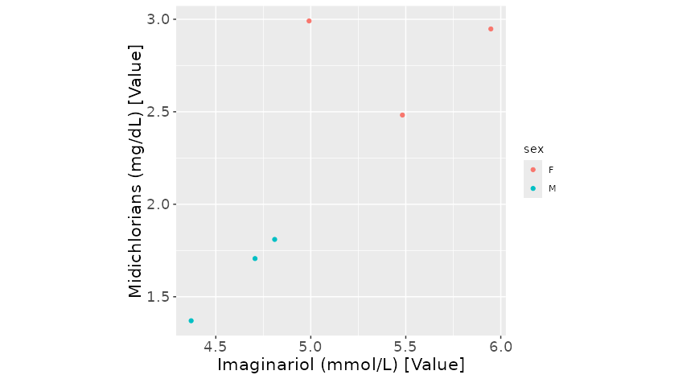
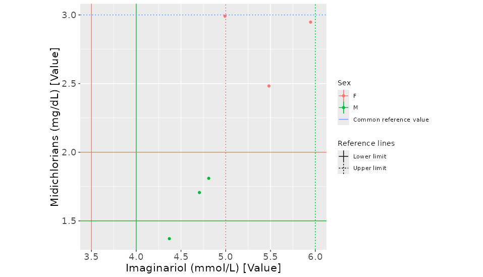
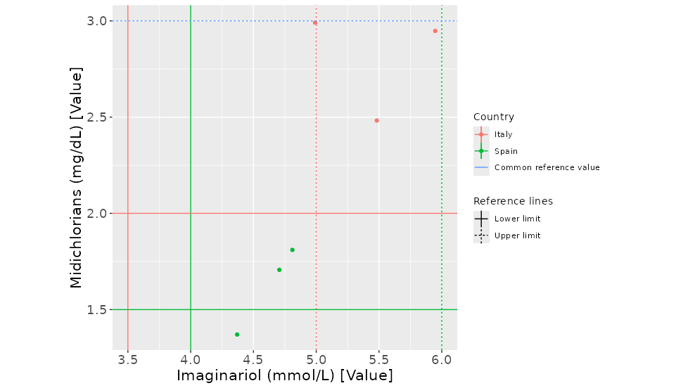
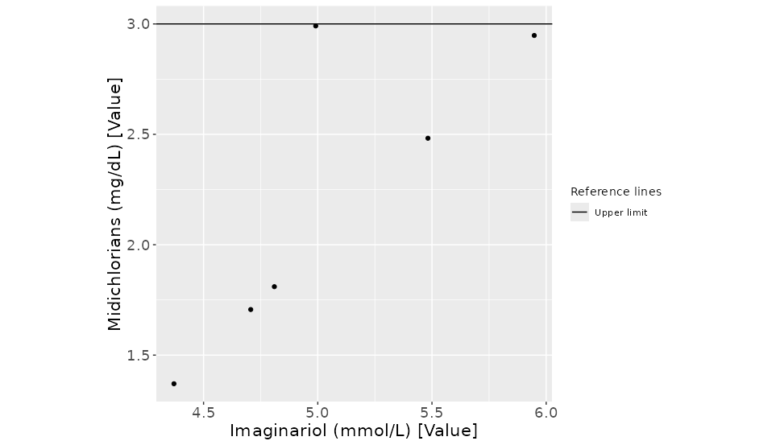
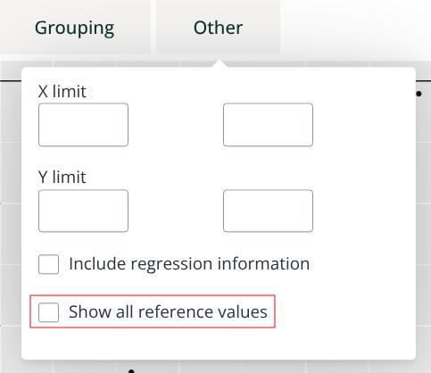
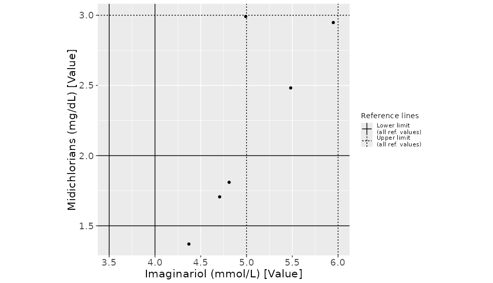
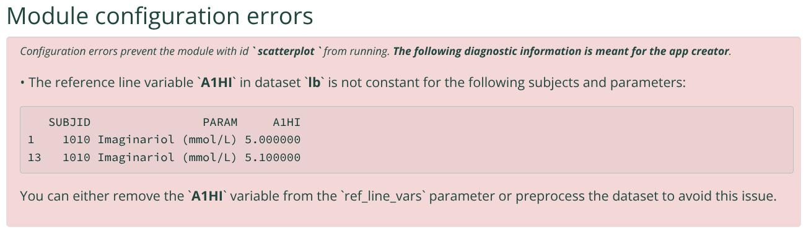

```{r, include = FALSE}
knitr::opts_chunk$set(
  collapse = TRUE,
  comment = "#>"
)
```

This article describes how to display reference values in `mod_scatterplot` charts and discusses the
behavior of reference lines in the presence of grouped data.

# A basic plot

As a starting point, let's imagine we want to inspect the following toy subject-level (`sl`) and laboratory values (`lb`) datasets:

<details><summary>Subject-level dataset <i><small>[expand/collapse]</small></i></summary>
```{r, echo = FALSE}
# Inspired in safetyData:adam_adsl
sl <- data.frame(
  SUBJID = c("1010", "1011", "1012", "1013", "1014", "1015") |> as.factor(),
  SEX = c("F", "F", "F", "M", "M", "M") |> as.factor(),
  RACE = rep("WHITE", 6) |> as.factor(),
  COUNTRY = c("Italy", "Italy", "Italy", "Spain", "Spain", "Spain") |> as.factor()
)
sl <- dv.explorer.parameter:::set_lbls(sl, c(SUBJID = "subjid", SEX = "sex", RACE = "race", COUNTRY = "country"))
knitr::kable(sl, format = "markdown")
```
</details>

<details><summary>Laboratory values dataset <i><small>[expand/collapse]</small></i></summary>
```{r, echo = FALSE}
# Inspired in safetyData:adam_lbc
lb <- data.frame(
  SUBJID = c("1010", "1011", "1012", "1013", "1014", "1015") |> rep(2L) |> as.factor(),
  PARCAT1 = rep("CHEM", 12L) |> as.factor(),
  PARAM = c(rep("Imaginariol (mmol/L)", 6L), rep("Midichlorians (mg/dL)", 6L)) |> as.factor(),
  AVISIT = rep("Baseline", 12L) |> as.factor(),
  AVAL = c(c(5.94780, 5.48232, 4.99098, 4.80996, 4.70652, 4.37034),
           c(2.94780, 2.48232, 2.99098, 1.80996, 1.70652, 1.37034)),
  A1LO = c(rep(1., 3L), rep(2., 3L), rep(1.5, 3L), rep(2.5, 3L)),
  A1HI = c(rep(3., 3L), rep(4., 3L), rep(3.5, 3L), rep(4.5, 3L))
)
lb <- dv.explorer.parameter:::set_lbls(lb, c(SUBJID = "subjid", PARCAT1 = "parcat1", PARAM = "param", AVISIT = "avisit", 
                     AVAL = "aval", A1LO = "a1lo", A1HI = "a1hi"))
knitr::kable(lb, format = "markdown")
```
</details>

```{r, echo = FALSE, eval = FALSE}
# Run this app to generate the plots # TODO: FIXME
module_list <- list(
  lineplot = dv.explorer.parameter::mod_lineplot(
    module_id = "lineplot", bm_dataset_name = "lb", group_dataset_name = "sl",
    subjid_var = "SUBJID", cat_var = "PARCAT1", par_var = "PARAM", value_vars = "AVAL",
    visit_vars = "AVISITN", default_cat = "CHEM", default_par = "Imaginariol (mmol/L)",
    #default_main_group = "SEX", # nolint
    ref_line_vars = c("A1LO", "A1HI")
  )
)

dv.manager::run_app(
  data = list("DS" = list(lb = lb, sl = sl)),
  module_list = module_list,
  filter_dataset_name = "sl",
  filter_key = "SUBJID"
)
```

We can do so by configuring `mod_lineplot` thus:
 
```{r, eval=FALSE}
dv.explorer.parameter::mod_scatterplot(
  module_id = "scatterplot", bm_dataset_name = "lb", group_dataset_name = "sl",
  subjid_var = "SUBJID", cat_var = "PARCAT1", par_var = "PARAM", 
  value_vars = "AVAL", visit_var = "AVISIT", 
  default_x_cat = "CHEM", default_x_par = "Imaginariol (mmol/L)",
  default_y_cat = "CHEM", default_y_par = "Midichlorians (mg/dL)",
  default_main_group = "SEX", default_include_regression_info = FALSE
)
```

Which generates the following plot: 


# Grouped and ungrouped reference values

We can modify that call to `mod_scatterplot` by providing a value for the `ref_line_vars` parameter so that it points to one or more `lb` numerical columns holding reference values:
```{r, eval=FALSE}
dv.explorer.parameter::mod_scatterplot(
  ..., ref_line_vars = c("A1LO", "A1HI")
)
```

Which produces:

Examining this plot, we can see the seven distinct reference values available in the original `bm` dataset. The Midichlorian Upper Limit 
value, common to all participants, is indicated with a dotted blue line. The rest of the reference values coincide with our selected grouping.
Since the base plot already provided colors for the "female" and "male" categories, `mod_scatterplot` paints their reference lines in matching colors.

# Which demographic variable dictates distinct reference values?

The original `bm` dataset does not explain which variable leads to participants having different reference values. Three out of six participants have a Midichlorian Lower Limit value of 1.5 while the other three have one of 2. It's likely that `SEX` is the variable that justifies the difference. However, given the totality of the data, `COUNTRY` would work just as well. If we change the main grouping to `COUNTRY`, the plot remains the same except for the grouping legend:

```{r, eval=FALSE}
dv.explorer.parameter::mod_scatterplot(
  ..., default_main_group = "COUNTRY", ref_line_vars = c("A1LO", "A1HI")
)
```


This plot is still factually correct in the sense that the color of each dot is color-matched with the Lower Limit value that 
shares the same row in the `lb` dataset.

# Disappearing reference lines

What happens if we don't provide a main grouping variable?

```{r, eval=FALSE}
dv.explorer.parameter::mod_scatterplot(
  ..., ref_line_vars = c("A1LO", "A1HI")
)
```
In this case, `mod_scatterplot` can't use color to pair the `A1LO` reference lines to the `AVAL` lines, so the reference lines are omitted:



Notice, however, that the `A1HI` value still applies to both black `AVAL` dots, so it is kept.

# Displaying all reference values

Sometimes it's useful to see *all* reference values regardless of whether they can be represented truthfully under some particular data grouping. To do that, users can override the built-in reference line filter by checking the "Show all reference values" option under the "Other" drop-down menu.



If we do that, all unique reference values are shown. The legend entries are also modified to point out the non-standard nature of the plot.



# Requirements for reference values

All reference value variables assigned to `ref_line_vars` should:

- be numerical
- remain constant across every combination of subject and parameter of the dataset

If one of these conditions is not met during module start-up, `mod_scatterplot` will produce a suitable error message, such as:


